<!--
  Generated by scripts/build.mjs from profile.json — edit profile.json, not this file.
  The images live on the "output" branch and are rebuilt every night by .github/workflows/build.yml.
-->

<picture><source media="(max-width: 600px) and (prefers-color-scheme: dark)" srcset="https://raw.githubusercontent.com/twoallbeefpatties/twoallbeefpatties/output/hero-m-dark.svg"><source media="(max-width: 600px)" srcset="https://raw.githubusercontent.com/twoallbeefpatties/twoallbeefpatties/output/hero-m-light.svg"><source media="(prefers-color-scheme: dark)" srcset="https://raw.githubusercontent.com/twoallbeefpatties/twoallbeefpatties/output/hero-dark.svg"></picture>

<a href="https://github.com/twoallbeefpatties"><picture><source media="(prefers-color-scheme: dark)" srcset="https://raw.githubusercontent.com/twoallbeefpatties/twoallbeefpatties/output/btn-github-dark.svg"></picture></a>&nbsp;<a href="https://www.linkedin.com/in/zacheryfrazier/"><picture><source media="(prefers-color-scheme: dark)" srcset="https://raw.githubusercontent.com/twoallbeefpatties/twoallbeefpatties/output/btn-linkedin-dark.svg"></picture></a>&nbsp;<a href="mailto:admin@chimpsec.com"><picture><source media="(prefers-color-scheme: dark)" srcset="https://raw.githubusercontent.com/twoallbeefpatties/twoallbeefpatties/output/btn-email-dark.svg"></picture></a>

<a href="https://github.com/twoallbeefpatties/nc-scripting-tool"><picture><source media="(max-width: 600px) and (prefers-color-scheme: dark)" srcset="https://raw.githubusercontent.com/twoallbeefpatties/twoallbeefpatties/output/now-m-dark.svg"><source media="(max-width: 600px)" srcset="https://raw.githubusercontent.com/twoallbeefpatties/twoallbeefpatties/output/now-m-light.svg"><source media="(prefers-color-scheme: dark)" srcset="https://raw.githubusercontent.com/twoallbeefpatties/twoallbeefpatties/output/now-dark.svg"></picture></a>
  

<picture><source media="(max-width: 600px) and (prefers-color-scheme: dark)" srcset="https://raw.githubusercontent.com/twoallbeefpatties/twoallbeefpatties/output/stack-m-dark.svg"><source media="(max-width: 600px)" srcset="https://raw.githubusercontent.com/twoallbeefpatties/twoallbeefpatties/output/stack-m-light.svg"><source media="(prefers-color-scheme: dark)" srcset="https://raw.githubusercontent.com/twoallbeefpatties/twoallbeefpatties/output/stack-dark.svg"></picture>

<picture><source media="(max-width: 600px) and (prefers-color-scheme: dark)" srcset="https://raw.githubusercontent.com/twoallbeefpatties/twoallbeefpatties/output/menu-m-dark.svg"><source media="(max-width: 600px)" srcset="https://raw.githubusercontent.com/twoallbeefpatties/twoallbeefpatties/output/menu-m-light.svg"><source media="(prefers-color-scheme: dark)" srcset="https://raw.githubusercontent.com/twoallbeefpatties/twoallbeefpatties/output/menu-dark.svg"></picture>
<a href="https://github.com/twoallbeefpatties/NCRestAPI"><picture><source media="(max-width: 600px) and (prefers-color-scheme: dark)" srcset="https://raw.githubusercontent.com/twoallbeefpatties/twoallbeefpatties/output/card-01-m-dark.svg"><source media="(max-width: 600px)" srcset="https://raw.githubusercontent.com/twoallbeefpatties/twoallbeefpatties/output/card-01-m-light.svg"><source media="(prefers-color-scheme: dark)" srcset="https://raw.githubusercontent.com/twoallbeefpatties/twoallbeefpatties/output/card-01-dark.svg"></picture></a> 
<a href="https://github.com/twoallbeefpatties/n-central-rest-api-mcp"><picture><source media="(max-width: 600px) and (prefers-color-scheme: dark)" srcset="https://raw.githubusercontent.com/twoallbeefpatties/twoallbeefpatties/output/card-02-m-dark.svg"><source media="(max-width: 600px)" srcset="https://raw.githubusercontent.com/twoallbeefpatties/twoallbeefpatties/output/card-02-m-light.svg"><source media="(prefers-color-scheme: dark)" srcset="https://raw.githubusercontent.com/twoallbeefpatties/twoallbeefpatties/output/card-02-dark.svg"></picture></a> 
<a href="https://github.com/twoallbeefpatties/NCRelay"><picture><source media="(max-width: 600px) and (prefers-color-scheme: dark)" srcset="https://raw.githubusercontent.com/twoallbeefpatties/twoallbeefpatties/output/card-03-m-dark.svg"><source media="(max-width: 600px)" srcset="https://raw.githubusercontent.com/twoallbeefpatties/twoallbeefpatties/output/card-03-m-light.svg"><source media="(prefers-color-scheme: dark)" srcset="https://raw.githubusercontent.com/twoallbeefpatties/twoallbeefpatties/output/card-03-dark.svg"></picture></a> 
<a href="https://github.com/twoallbeefpatties/homelab-mcp"><picture><source media="(max-width: 600px) and (prefers-color-scheme: dark)" srcset="https://raw.githubusercontent.com/twoallbeefpatties/twoallbeefpatties/output/card-04-m-dark.svg"><source media="(max-width: 600px)" srcset="https://raw.githubusercontent.com/twoallbeefpatties/twoallbeefpatties/output/card-04-m-light.svg"><source media="(prefers-color-scheme: dark)" srcset="https://raw.githubusercontent.com/twoallbeefpatties/twoallbeefpatties/output/card-04-dark.svg"></picture></a> 
<a href="https://github.com/twoallbeefpatties/nable-skills"><picture><source media="(max-width: 600px) and (prefers-color-scheme: dark)" srcset="https://raw.githubusercontent.com/twoallbeefpatties/twoallbeefpatties/output/card-05-m-dark.svg"><source media="(max-width: 600px)" srcset="https://raw.githubusercontent.com/twoallbeefpatties/twoallbeefpatties/output/card-05-m-light.svg"><source media="(prefers-color-scheme: dark)" srcset="https://raw.githubusercontent.com/twoallbeefpatties/twoallbeefpatties/output/card-05-dark.svg"></picture></a> 
<a href="https://github.com/twoallbeefpatties?tab=repositories"><picture><source media="(max-width: 600px) and (prefers-color-scheme: dark)" srcset="https://raw.githubusercontent.com/twoallbeefpatties/twoallbeefpatties/output/card-all-m-dark.svg"><source media="(max-width: 600px)" srcset="https://raw.githubusercontent.com/twoallbeefpatties/twoallbeefpatties/output/card-all-m-light.svg"><source media="(prefers-color-scheme: dark)" srcset="https://raw.githubusercontent.com/twoallbeefpatties/twoallbeefpatties/output/card-all-dark.svg"></picture></a>

<picture><source media="(max-width: 600px) and (prefers-color-scheme: dark)" srcset="https://raw.githubusercontent.com/twoallbeefpatties/twoallbeefpatties/output/grill-m-dark.svg"><source media="(max-width: 600px)" srcset="https://raw.githubusercontent.com/twoallbeefpatties/twoallbeefpatties/output/grill-m-light.svg"><source media="(prefers-color-scheme: dark)" srcset="https://raw.githubusercontent.com/twoallbeefpatties/twoallbeefpatties/output/grill-dark.svg"></picture>

<picture><source media="(max-width: 600px) and (prefers-color-scheme: dark)" srcset="https://raw.githubusercontent.com/twoallbeefpatties/twoallbeefpatties/output/facts-m-dark.svg"><source media="(max-width: 600px)" srcset="https://raw.githubusercontent.com/twoallbeefpatties/twoallbeefpatties/output/facts-m-light.svg"><source media="(prefers-color-scheme: dark)" srcset="https://raw.githubusercontent.com/twoallbeefpatties/twoallbeefpatties/output/facts-dark.svg"></picture>

<picture><source media="(max-width: 600px) and (prefers-color-scheme: dark)" srcset="https://raw.githubusercontent.com/twoallbeefpatties/twoallbeefpatties/output/footer-m-dark.svg"><source media="(max-width: 600px)" srcset="https://raw.githubusercontent.com/twoallbeefpatties/twoallbeefpatties/output/footer-m-light.svg"><source media="(prefers-color-scheme: dark)" srcset="https://raw.githubusercontent.com/twoallbeefpatties/twoallbeefpatties/output/footer-dark.svg"></picture>
